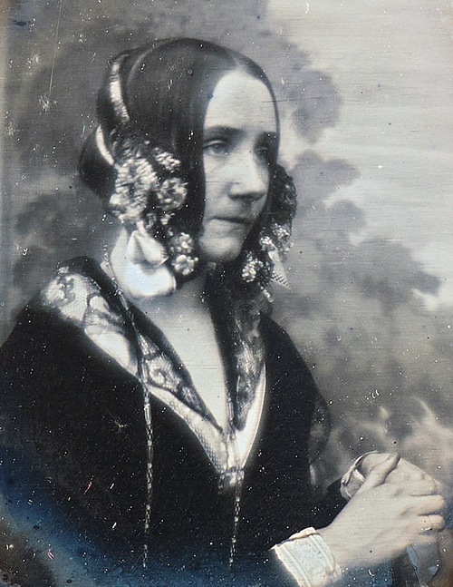

[← Volver al inicio](README.md)

# Temas del curso

### 16/09 · Mis aficiones

Llevo ya casi un año aficionado a las colonias, sobre todo a las árabes, ya que replican el olor de colonias de muy alta calidad sin perderla por un precio bastante asequible para todo el mundo. Tengo una colección de 27 colonias, siendo 24 de estas árabes. La verdad que es un hobbie que me entretiene bastante, ya que no es solo olerlas, también es un juego en el que intentas deducir todas las notas y olores que tiene, además como comparto esta afición con mi padre, me puedo permitir gastar más dinero en ella, ya que no cuento solo con el mío a la hora de comprarlas.

Buscando en GitHub he encontrado [PerfumAPI](https://github.com/seccaz/PerfumAPI), una página que te ayuda a encontrar todo tipo de colonias y marcas.

---

###  02/10 · Premios Princesa de Asturias: Leo Messi

Qué ha hecho: Messi ha desarrollado una trayectoria deportiva excepcional (el jurado destaca que es el jugador que más títulos ha conquistado en la historia del fútbol) y ha realizado una labor solidaria continuada para promover el acceso a la educación y el cuidado de la salud de los niños más desfavorecidos. También destaca su comportamiento dentro del campo, su constancia, humildad y compromiso con el juego colectivo.

Por qué le premian: el premio reconoce conjuntamente su talento y trayectoria deportiva y, de manera explícita, su labor solidaria en favor de niños desfavorecidos, especialmente en educación y salud. 

[Su página en la Fundación](https://www.fpa.es/es/premios-princesa-de-asturias/premiados/2026-leo-messi/)

Imagen: Дмитрий Садовников, [Wikipedia Commons](https://commons.wikimedia.org/wiki/File:Lionel_Messi_2017.jpg)

---

### 16/10 · Ada Lovelace

Ada Lovelace (1815-1852) fue una matemática y escritora británica, hija del poeta Lord Byron. En 1843, escribió instrucciones para la máquina analítica de Charles Babbage, por lo que se la considera una de las primeras programadoras de la historia. Su día se celebra para reconocer las aportaciones de las mujeres a la ciencia y la tecnología. El Día de Ada Lovelace se conmemora el segundo martes de octubre; en 2026, es el 13 de octubre. 

Fuentes fiables para consultar:

UNESCO: Ada Lovelace 

Universidad de St Andrews: biografía de Ada Lovelace

*Imagen: Antoine Claudet, [Wikimedia Commons](https://commons.wikimedia.org/wiki/File:Ada_Lovelace_daguerreotype_by_Antoine_Claudet_1843_-_cropped.png)*

---
